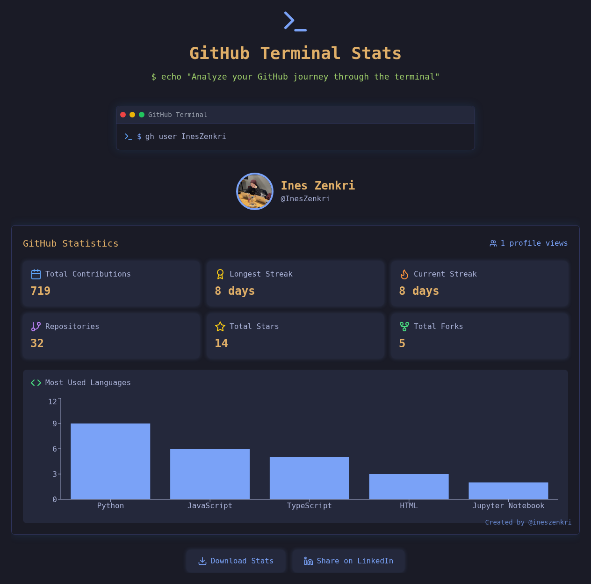
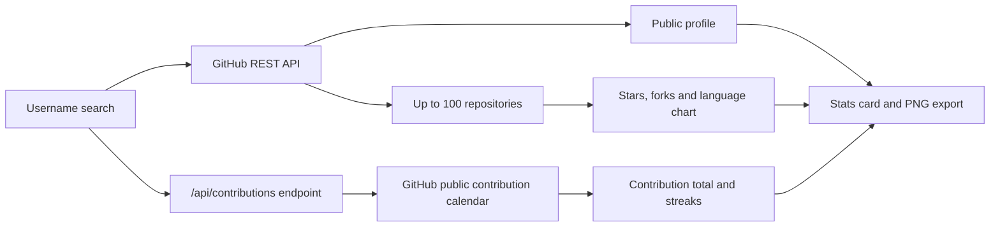

# GitHub Insights

A terminal-style GitHub statistics frontend built with React, TypeScript and Vite. Search for a GitHub username to view public profile information, repository totals, real contribution statistics and a language chart, then download the stats card as a PNG.

## Preview



*The app after running `gh user InesZenkri`, captured from the current build of this repository on 27 October 2026. Contribution totals and streaks come from the public contribution calendar GitHub shows on the user's profile. The chart counts public repositories by primary language, not lines of code.*

Try `gh user InesZenkri` in the terminal prompt on the [live demo](https://github-insights.netlify.app/).

## How data reaches the screen



The `/api/contributions` endpoint is a Netlify function in production and a Vite middleware in local development. It reads the public contribution calendar GitHub serves for every user, so it needs no token.

## Data and limitations

- **Real GitHub data:** profile details, public repositories, stars and forks come from the GitHub REST API.
- **Real contribution data:** contribution totals, current streak and longest streak come from the same public contribution calendar GitHub displays on the user's profile, covering roughly the last year. If a searched user has enabled GitHub's setting to show anonymized private contributions on their profile, those counts are included; private repository details are never exposed. If the calendar cannot be loaded, the app shows an error instead of placeholder numbers.
- Repository totals cover the first page of up to 100 repositories, not necessarily the user's full account.
- The language chart counts repositories by their primary language. It does not measure lines of code or language proficiency.
- The visitor counter uses an external service and falls back to `1` when that service fails.

## Features

- Search public GitHub profiles by username.
- Display repository, star and fork totals for the fetched repositories.
- Show real contribution totals and current and longest streaks.
- Show the five most common primary repository languages.
- Download the displayed stats card as a PNG.
- Open LinkedIn sharing for the app's URL.

## Run locally

Install Node.js with npm and Git, then:

```bash
git clone https://github.com/InesZenkri/Github-Insights.git
cd Github-Insights
npm ci
npm run dev
```

Open the local URL printed by Vite. The dev server also serves `/api/contributions`, so contribution statistics work locally without extra setup.

The app can request public GitHub data without a token, subject to GitHub's unauthenticated API rate limits. Do not put a personal access token in `VITE_GITHUB_TOKEN` for a public deployment: Vite environment variables used by frontend code are exposed to the browser.

## Commands

| Command | Purpose |
| --- | --- |
| `npm run dev` | Start the Vite development server |
| `npm run build` | Build the frontend into `dist/` |
| `npm run preview` | Preview the production build locally |
| `npm run lint` | Run ESLint |
| `npm test` | Run the contribution-calendar parser tests |

## Stack

React, TypeScript, Vite, Tailwind CSS, React Query, Axios, Recharts and html-to-image, plus a Netlify serverless function that serves contribution data. This repository contains the frontend, not a Python/Flask backend.

## License

[MIT](LICENSE)
