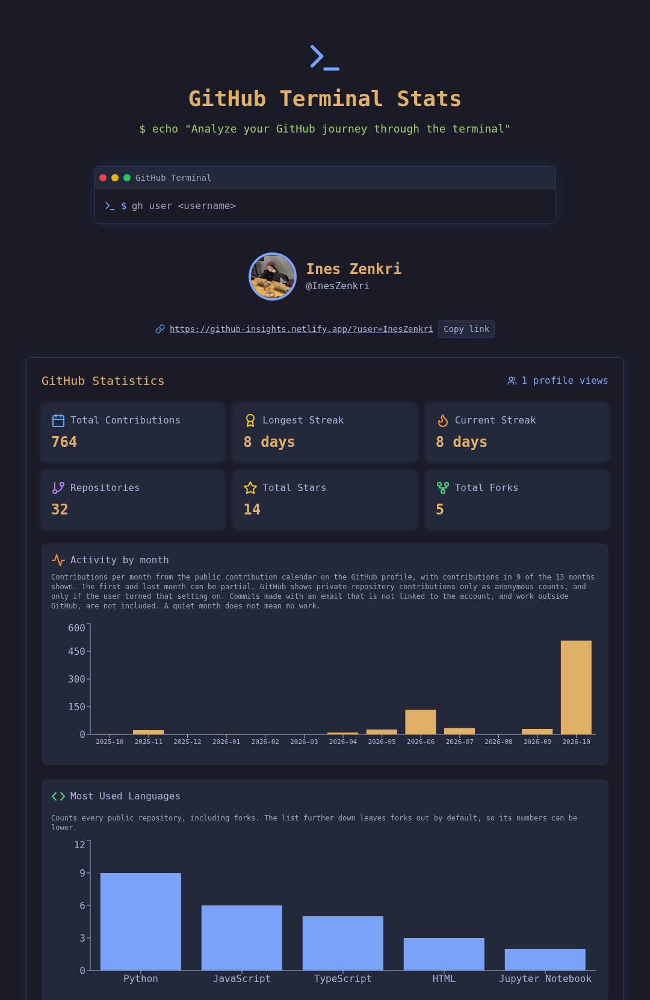
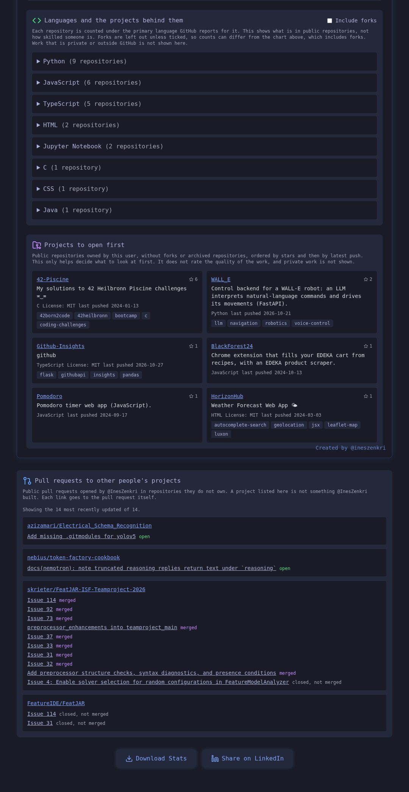
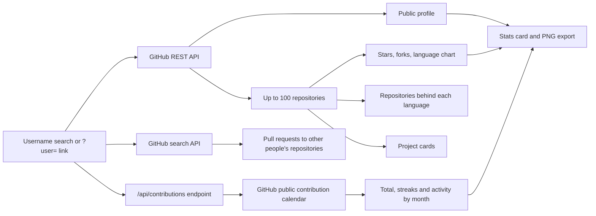

# GitHub Insights

A terminal-style GitHub statistics frontend built with React, TypeScript and Vite. Search for a GitHub username, or open a link like `?user=InesZenkri`, to see public profile information, repository totals, real contribution statistics and activity by month, plus evidence a recruiter can open: the repositories behind each language, projects to look at first, and pull requests to other people's projects. The stats card can be downloaded as a PNG.

## Preview





*The app after opening `?user=InesZenkri`, captured from the live deployment on 27 October 2026. Contribution totals, streaks and monthly activity come from the public contribution calendar GitHub shows on the user's profile. The language chart counts public repositories by primary language, not lines of code. The pull request list sits below the section shown in the second image.*

Try it on the [live demo](https://github-insights.netlify.app/?user=InesZenkri), or type `gh user InesZenkri` in the terminal prompt.

## How data reaches the screen



The `/api/contributions` endpoint is a Netlify function in production and a Vite middleware in local development. It reads the public contribution calendar GitHub serves for every user, so it needs no token.

## What the recruiter sections show

The app lists evidence with links and does not rate people. It shows no skill scores, no ranking or comparison of people, and no job-fit labels. The only ordering is of one person's own repositories, by a rule shown on screen.

- **Languages and the projects behind them:** each repository is counted under the primary language GitHub reports for it, with a link, description, stars and last push date. Forks are left out unless "Include forks" is ticked. The chart above it counts every public repository, including forks.
- **Projects to open first:** up to six own repositories (no forks, no archived), ordered by stars and then latest push. The rule is shown on screen. It decides what to open first and is not a quality rating. License and topics appear only when GitHub lists them.
- **Pull requests to other people's projects:** public pull requests the user opened in repositories they do not own, grouped by repository, each linking to the pull request with its state: merged, open, or closed without merge. A listed project is not something the user built. The latest 30 are shown with the total count.
- **Activity by month:** contributions per month from the public contribution calendar. The first and last month can be partial.
- **Shareable link:** `?user=<username>` opens a profile directly, and a "Copy link" row appears above the stats.

## Data and limitations

- **Public data only.** Missing data is not evidence of missing work: private work, work outside GitHub and work on other platforms do not appear.
- **Real GitHub data:** profile details, public repositories, stars and forks come from the GitHub REST API.
- **Contribution data:** totals, streaks and monthly counts come from the public contribution calendar on the user's profile, covering roughly the last year. GitHub shows private-repository contributions there only as anonymous counts, and only if the user turned that setting on. For commits, GitHub's documented rules mean that those made with an email address not linked to the account, commits in forks that were never merged upstream, and commits outside the default branch do not appear in the calendar. Other activity types follow GitHub's own rules. The app shows only what GitHub's public calendar displays. If the calendar cannot be loaded, the app shows an error instead of placeholder numbers.
- Repository-based sections cover the first page of up to 100 repositories, most recently updated first, not necessarily the user's full account. The language section warns when that limit is reached.
- The language views count repositories by primary language. They do not measure lines of code or proficiency.
- The pull request list uses GitHub's search API, which allows 10 requests per minute without a token. If it fails, the app says it could not load the list, which does not mean there are none. The rest of the profile still shows.
- The repository requests share GitHub's unauthenticated limit of 60 requests per hour per IP address.
- The visitor counter uses an external service and falls back to `1` when that service fails.

## Features

- Search public GitHub profiles by username, or open a `?user=` link.
- Repository, star and fork totals for the fetched repositories.
- Real contribution totals, current and longest streaks, and contributions per month.
- Top five primary repository languages in a chart, and a full list of languages with the repositories behind them.
- Project cards with description, language, topics, license and last push.
- Pull requests to other people's projects with their merged, open or closed state.
- Download the displayed stats card as a PNG.
- Open LinkedIn sharing for the app's URL.

## Run locally

Install Node.js with npm and Git, then:

```bash
git clone https://github.com/InesZenkri/Github-Insights.git
cd Github-Insights
npm ci
npm run dev
```

Open the local URL printed by Vite. The dev server also serves `/api/contributions`, so contribution statistics work locally without extra setup.

The app can request public GitHub data without a token, subject to GitHub's unauthenticated API rate limits. Do not put a personal access token in `VITE_GITHUB_TOKEN` for a public deployment: Vite environment variables used by frontend code are exposed to the browser.

## Commands

| Command | Purpose |
| --- | --- |
| `npm run dev` | Start the Vite development server |
| `npm run build` | Build the frontend into `dist/` |
| `npm run preview` | Preview the production build locally |
| `npm run lint` | Run ESLint |
| `npm test` | Run the contribution-calendar parser tests |

## Stack

React, TypeScript, Vite, Tailwind CSS, React Query, Axios, Recharts and html-to-image, plus a Netlify serverless function that serves contribution data. This repository contains the frontend, not a Python/Flask backend.

## License

[MIT](LICENSE)
